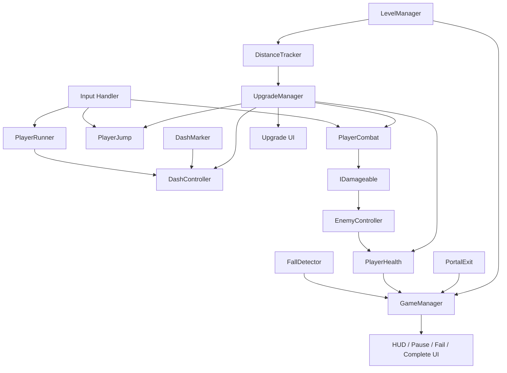

# 《天台疾行》游戏玩法拆分文档

> 版本：V1.0  
> 用途：定义游戏玩法、系统边界、状态流转和模块之间的关系，作为 Unity 实现与测试的依据。

---

## 1. 游戏概述

《天台疾行》是一款 2D 横版像素风自动跑酷动作游戏。玩家在城市屋顶上自动向前奔跑，通过跳跃、主动攻击和疾行印记冲刺应对障碍与怪物，并在固定距离节点选择随机增益，最终抵达传送点完成关卡。

### 已确定的设计

- 自动向前奔跑。
- 单次跳跃，二段跳由增益解锁。
- 玩家主动按键攻击。
- 触碰疾行印记自动触发冲刺。
- 每关有明确终点，通关后解锁下一关。
- 生命值归零或掉落屋顶时失败。
- 每到固定距离节点触发三选一增益。
- 单关目标时长约 2–4 分钟。
- 失败后重新开始当前关卡，本局增益清空。
- 首版不做局外永久属性成长。
- 首版采用手工关卡，不随机生成整张地图。

### 设计目标

1. 角色操作简单，但时机判断有深度。
2. 冲刺标记是视觉和玩法上的核心识别点。
3. 增益改变玩家处理关卡的方式，而不只是提升数值。
4. 关卡不依赖特定随机增益才能通关。
5. 模块结构适合单人开发、调试和扩展。

---

## 2. 单局核心循环

```text
进入关卡
  ↓
角色自动前进
  ↓
玩家观察地形并操作
  ├── 跳跃跨越间隙
  ├── 主动攻击怪物
  ├── 躲避陷阱与敌人
  └── 触碰疾行印记，自动冲刺
  ↓
到达固定距离节点
  ↓
暂停游戏，展示 3 个增益
  ↓
玩家选择一个增益
  ↓
恢复游戏，继续挑战
  ↓
到达第二个增益节点
  ↓
选择增益并继续前进
  ↓
抵达传送点 ──→ 通关结算
  │
  └── 生命归零或掉落 ──→ 失败结算 ──→ 重开当前关卡
```

### 单局节奏建议

- 关卡目标时长：约 3 分钟。
- 常规增益节点：2 个。
- 起点前段：教学和建立节奏。
- 中段：组合地形、怪物与印记。
- 后段：检验玩家对已选增益的利用。
- 结尾：抵达传送点并结算。

时长与距离需在原型测试后调整，不要先把具体距离写死在代码中。

---

## 3. 玩家控制模块

### 3.1 自动奔跑

**职责**
- 持续推动角色向前。
- 提供可调基础速度。
- 支持冲刺时临时改变移动速度。
- 在暂停、失败和通关时停止。

**输入**
- 当前游戏状态。
- 基础奔跑速度。
- 冲刺状态与速度修正。

**输出**
- 角色水平移动。

**规则**
- 玩家不控制左右移动。
- 普通攻击不停止奔跑。
- 基础速度先保持稳定，不随关卡进度自动无限加速。
- 速度只允许由明确的游戏机制修改。

**异常与边界**
- 游戏暂停时不得继续移动。
- 失败和通关后不得继续移动。
- 冲刺结束后恢复正确基础速度。
- 不应由多个脚本同时写入角色水平速度。

### 3.2 跳跃

**职责**
- 响应跳跃输入。
- 检查是否允许起跳。
- 管理离地、空中和落地状态。
- 支持增益解锁的二段跳。

**基础规则**
- 未获得二段跳时，每次离地只能跳一次。
- 落地后重置跳跃次数。
- 跳跃期间继续向前移动。
- 允许适度空中控制，但不允许空中无限修正。
- 所有主线地形必须能用基础单次跳跃通过。

**二段跳增益**
- 获得后增加一次空中起跳机会。
- 同一跳跃周期内只能触发一次额外跳跃。
- 落地后重置次数。
- 重新开始关卡时清除该能力，除非它在未来被设计为永久解锁；首版不采用永久解锁。

### 3.3 输入管理

建议把输入读取与玩法执行分开。

- 输入层读取跳跃、攻击、暂停和卡片选择。
- 角色模块判断当前状态是否允许执行。
- UI 打开时，玩法输入不应误触发攻击或跳跃。
- 失败与通关状态下，普通玩法输入失效。

---

## 4. 疾行印记与冲刺模块

### 4.1 疾行印记

**职责**
- 检测玩家进入印记触发区域。
- 每个印记每局默认只触发一次。
- 请求 `DashController` 执行冲刺。
- 提供发光、动画或音效提示。

**触发条件**
- 玩家进入印记 Trigger。
- 当前游戏状态为 Playing。
- 角色当前不处于禁止冲刺的状态。
- 该印记尚未触发。

### 4.2 冲刺状态

建议状态：

```text
Running
  ↓ 触发印记
Dashing
  ↓ 持续时间或距离结束
Running
```

冲刺中可能出现的特殊事件：

- 玩家跳跃：首版建议允许，但必须测试与地形碰撞的兼容性。
- 玩家攻击：首版暂时禁止普通攻击，避免动作与判定冲突。
- 玩家受击：按伤害规则处理；冲刺默认不提供无敌。
- 玩家掉落：掉落失败优先级高于冲刺。
- 游戏暂停：停止冲刺计时。
- 游戏失败或通关：立即终止冲刺。

### 4.3 冲刺规则

- 方向固定向前。
- 冲刺速度、持续时间或最大距离可配置。
- 冲刺结束后恢复基础速度。
- 冲刺不得无条件穿过关卡碰撞体。
- 冲刺默认不造成伤害；后续可通过增益增加击退、冲击波或冲刺伤害。
- 每个印记不能重复触发，除非某种特殊机制明确允许。

### 4.4 冲刺的视觉反馈

至少需要：
- 印记的待触发状态。
- 触发瞬间的亮光或缩放反馈。
- 角色冲刺拖尾或速度线。
- 冲刺音效。
- 冲刺结束的视觉提示。

视觉反馈是核心机制的一部分，不能只实现速度变化而没有反馈。

---

## 5. 战斗模块

### 5.1 主动攻击

**职责**
- 接收攻击请求。
- 检查攻击冷却和角色状态。
- 在指定时间窗开启攻击判定。
- 对命中的敌人造成伤害。
- 播放攻击动画和音效。

**规则**
- 默认朝向前方攻击。
- 不需要鼠标瞄准。
- 攻击不暂停自动奔跑。
- 攻击有明确冷却时间。
- 一次攻击不得因为判定区持续存在而每帧重复伤害同一敌人。
- 冲刺期间暂时禁止普通攻击。
- 攻击范围、伤害、冷却与判定持续时间应可配置。

### 5.2 伤害接口

建议使用统一的受伤接口，例如 `IDamageable`，避免玩家攻击脚本直接依赖每种怪物的具体类。

统一受伤流程：

```text
攻击输入
  ↓
检查攻击状态与冷却
  ↓
开启攻击判定
  ↓
检测可受伤目标
  ↓
调用目标受伤接口
  ↓
目标处理伤害、击退与死亡
```

### 5.3 普通怪物

首版只需一种基础怪物。

**建议行为**
- 在固定位置或有限范围内移动。
- 对接触到的玩家造成伤害，或进行简单的前方攻击。
- 受到玩家攻击后扣血并产生反馈。
- 生命值归零后死亡、关闭碰撞并移除攻击能力。

**设计原则**
- 普通怪物不应成为永久的物理墙。
- 不应迫使玩家停下来等待怪物。
- 通过接触伤害、攻击窗口、位置和击退产生威胁。
- 先把一种怪物做稳定，再增加飞行怪或重甲怪。

---

## 6. 生命值、受击与失败模块

### 6.1 生命值

建议包含：
- 当前生命值。
- 最大生命值。
- 受到伤害的方法。
- 恢复生命的方法。
- 生命值变化事件。
- 生命值归零事件。

### 6.2 受击规则

- 受到敌人或危险障碍伤害时扣除生命值。
- 受击后可获得短暂的无敌保护，防止同一碰撞连续扣血。
- 无敌时间应有明显视觉反馈。
- 生命值归零只触发一次失败。
- 首版不设置复杂的击倒、流血、中毒等状态。

### 6.3 掉落失败

- 在关卡底部设置掉落检测区域。
- 玩家进入区域后直接进入失败流程。
- 掉落属于独立的致命失败，不消耗生命值后继续。
- 失败动画可以短暂播放，但不能让玩家等待过久。

### 6.4 失败流程

```text
生命值归零 / 进入掉落区域
  ↓
GameManager 切换到 Failed
  ↓
停止角色、敌人、攻击和冲刺逻辑
  ↓
显示失败 UI
  ├── 重新开始当前关卡
  └── 返回关卡选择
```

### 6.5 重开必须重置的状态

- 玩家位置、速度和跳跃次数。
- 玩家生命值与受击保护状态。
- 当前冲刺状态与已触发的印记状态。
- 本局已选择的增益和增益等级。
- 距离计数与增益节点触发标记。
- 敌人生命值、状态和位置。
- 临时计分、连锁值等局内数据。
- UI 面板、暂停状态和时间缩放。

已解锁的关卡进度不清空。

---

## 7. 固定距离与关卡进度模块

### 7.1 距离追踪

**职责**
- 记录本局实际前进距离。
- 读取当前关卡的增益节点配置。
- 判断是否到达未触发节点。
- 更新进度 UI。
- 防止节点重复触发。

建议不要简单使用“游戏总时间 × 速度”推算距离，因为冲刺会改变速度。应根据角色实际位移或关卡推进量计算。

### 7.2 增益节点规则

- 每关默认设置两个节点。
- 节点距离属于关卡数据。
- 到达节点后先检查游戏是否仍处于 Playing。
- 触发节点时暂停游戏并打开增益选择。
- 选择完成后标记节点已处理，再恢复游戏。
- 玩家跨过距离阈值时仍必须触发，不能因为单帧位移较大而漏掉。
- 失败或通关后不再触发节点。

### 7.3 关卡进度 UI

可以显示：
- 当前关卡名称或编号。
- 进度条。
- 已到达的增益节点状态。
- 终点方向或剩余距离（视 UI 设计决定）。

首版不必同时显示过多数字，保持画面清爽。

---

## 8. 增益系统

### 8.1 增益数据

建议通过 `UpgradeDefinition` ScriptableObject 保存静态数据：

- 唯一 ID。
- 显示名称。
- 简短描述。
- 图标。
- 增益类型。
- 品质。
- 最大等级。
- 是否可重复获取。
- 效果参数。
- 是否为一次性解锁。
- 前置条件或互斥规则（只有确实需要时才增加）。

运行时单独记录：
- 本局已获得的增益。
- 当前等级。
- 已解锁的能力。
- 已处理的增益节点。

不要在运行时直接修改项目资产里的 ScriptableObject 数值。

### 8.2 抽取规则

- 每次展示三个不同的有效选项。
- 排除已满级且没有替代效果的增益。
- 二段跳这类一次性能力获得后，后续不应再次以相同解锁效果出现。
- 如果候选不足三个，应有明确回退策略，例如允许合适的重复强化，或从备用池补足。
- 首版先采用简单随机抽取，不做复杂的动态概率系统。
- 可以轻度提高与已选方向相关的强化出现机会，但应先完成基础版本再做。

### 8.3 首版候选增益

| 名称 | 类型 | 效果方向 |
|---|---|---|
| 二段跳 | 解锁 | 空中增加一次跳跃机会 |
| 轻盈身法 | 强化 | 提高空中控制能力 |
| 高跳 | 强化 | 提高跳跃高度 |
| 疾行延长 | 强化 | 增加冲刺持续距离 |
| 冲击波 | 解锁 | 冲刺结束时击退附近怪物 |
| 冲刺护体 | 解锁 | 冲刺期间抵挡一次普通伤害 |
| 余势加速 | 解锁 | 冲刺结束后短暂加速 |
| 攻击强化 | 强化 | 提高普通攻击伤害 |
| 扩大攻击 | 强化 | 增加攻击判定范围 |
| 快速出手 | 强化 | 缩短攻击冷却 |
| 生命提升 | 强化 | 增加最大生命并恢复少量生命 |
| 受击保护 | 强化 | 增加受击后的短暂无敌时间 |

以上为候选池。首个可玩版本建议先实现 6 个效果明确、容易测试的增益。

### 8.4 增益应用方式

建议采用明确的效果处理方式：
- `PlayerJump` 负责跳跃相关增益。
- `DashController` 负责冲刺相关增益。
- `PlayerCombat` 负责攻击相关增益。
- `PlayerHealth` 负责生命与受击相关增益。
- `UpgradeManager` 只负责抽取、记录和协调应用，不直接承载所有增益逻辑。

这样能避免增益系统变成一个难以维护的巨型脚本。

### 8.5 增益 UI

每张卡片展示：
- 图标。
- 名称。
- 一句话描述。
- 品质或等级。
- 选择反馈。

进入选择时：
1. 游戏状态切换到 UpgradeSelecting。
2. 暂停世界玩法。
3. 显示三张卡片。
4. 玩家选择其中一张。
5. 应用增益并记录本局状态。
6. 关闭卡片 UI。
7. 恢复 Playing。

---

## 9. 关卡与终点模块

### 9.1 首版关卡结构

建议手工制作一张完整关卡：

1. 起跑安全区。
2. 基础跳跃教学。
3. 第一组屋顶间隙。
4. 第一个疾行印记。
5. 第一次增益节点。
6. 怪物与障碍组合。
7. 第二组疾行印记或跳跃挑战。
8. 第二次增益节点。
9. 最后挑战区。
10. 终点传送点。

### 9.2 关卡设计原则

- 主线路径必须可以在没有二段跳的情况下完成。
- 印记不能将玩家自动带入不可避免的致命陷阱。
- 障碍需要留出合理反应时间。
- 增益节点应放在相对安全的地形区。
- 首版固定布局，优先保证体验和可调试性。
- 后续可以复用屋顶片段，但不要一开始就做完整程序化生成。

### 9.3 终点传送点

**触发条件**
- 玩家进入传送点 Trigger。
- 当前状态为 Playing。

**触发后**
- 切换到 Completed。
- 停止角色和敌人玩法逻辑。
- 禁用新的攻击、受击、冲刺和增益触发。
- 播放通关表现。
- 显示结算 UI。
- 保存关卡解锁进度。

### 9.4 通关统计

首版可以展示：
- 通关时间。
- 受到的伤害次数或剩余生命值。
- 冲刺触发次数。
- 已选择增益。

统计数据先用于反馈，不必立刻影响奖励。

---

## 10. 游戏状态管理

建议使用一个统一的 `GameManager` 管理状态，而不是让各个模块分别暂停游戏。

### 状态定义

- `Playing`：正常游玩。
- `UpgradeSelecting`：选择增益。
- `Paused`：玩家主动暂停。
- `Failed`：关卡失败。
- `Completed`：关卡完成。

### 状态规则

| 当前状态 | 允许操作 | 禁止行为 |
|---|---|---|
| Playing | 跳跃、攻击、冲刺、移动 | 无 |
| UpgradeSelecting | 选择一张增益卡 | 角色移动、攻击、敌人行动 |
| Paused | 恢复或退出 | 世界玩法继续运行 |
| Failed | 重开、返回 | 继续移动、攻击、触发增益 |
| Completed | 下一关、返回 | 继续受伤、触发增益 |

### 暂停注意事项

如果使用 `Time.timeScale = 0`：
- 依赖 `Time.deltaTime` 的逻辑会停止推进。
- UI 动画如果需要在暂停时播放，应使用不受缩放影响的时间方式。
- Animator、粒子、音频和协程要分别验证暂停行为。
- 恢复时要恢复正确的时间缩放值，避免固定写成 1 而覆盖其他暂停来源。

---

## 11. UI 模块

首版需要的 UI：

### 关卡 HUD
- 生命值显示。
- 关卡进度。
- 暂停按钮或提示。
- 可选的冲刺状态提示。

### 增益选择 UI
- 三张卡片。
- 名称、图标、效果描述。
- 选择反馈。

### 暂停 UI
- 继续游戏。
- 重开关卡。
- 返回关卡选择。

### 失败 UI
- 失败提示。
- 重新开始。
- 返回关卡选择。

### 通关 UI
- 通关提示。
- 基础统计。
- 下一关。
- 返回关卡选择。

UI 只负责展示和收集玩家选择。实际规则由对应的游戏系统处理。

---

## 12. 系统关系图



### 依赖说明
- 输入层不负责实际战斗规则。
- 玩家移动、跳跃、攻击与冲刺分开实现。
- 怪物通过统一受伤接口处理伤害。
- 增益管理器负责选择与协调，不负责替代各个模块。
- 失败、通关和暂停统一由游戏状态管理协调。
- 关卡管理器负责重开和切换关卡。

---

## 13. 关键边界情况

以下情况必须专门测试：

1. 冲刺期间触发增益节点。
2. 玩家在增益选择前一刻掉落。
3. 玩家生命值归零的同一帧触碰传送点。
4. 冲刺期间触碰多个印记。
5. 玩家攻击判定连续碰到同一敌人。
6. 玩家受击保护期间连续接触敌人。
7. 一帧跨过增益节点距离。
8. 已获得二段跳后再次抽到二段跳。
9. 所有候选增益都已满级或不可用。
10. 暂停后立刻重开。
11. 失败后迅速重复点击重开。
12. 通关后仍有敌人攻击判定留在场景中。
13. 游戏暂停期间动画、音频或粒子继续播放。
14. 连续重开多次后事件被重复订阅。

### 事件优先级建议

当多个事件在极短时间内同时发生时，优先级建议为：

1. 已经判定的失败。
2. 已经判定的通关。
3. 增益选择。
4. 普通攻击与冲刺状态变化。

失败与通关如果可能同帧发生，需要在 `GameManager` 中定义唯一的最终状态，防止同时弹出两个界面。具体应以游戏设计确定的碰撞判定规则为准。

---

## 14. 玩法验收清单

### 自动跑酷
- [ ] 自动前进稳定。
- [ ] 攻击不停止奔跑。
- [ ] 暂停、失败和通关会停止移动。

### 跳跃
- [ ] 基础单次跳跃正常。
- [ ] 落地后恢复跳跃机会。
- [ ] 二段跳只在获得增益后启用。
- [ ] 基础关卡不依赖二段跳。

### 冲刺
- [ ] 印记只触发一次。
- [ ] 冲刺结束恢复正常速度。
- [ ] 冲刺受地形碰撞约束。
- [ ] 冲刺期间的跳跃、受击和攻击规则一致。

### 战斗
- [ ] 玩家可以主动攻击。
- [ ] 攻击有冷却和有效判定窗口。
- [ ] 同一次攻击不会意外重复伤害。
- [ ] 怪物死亡后停止造成伤害。

### 增益
- [ ] 每次出现三个有效选项。
- [ ] 选择期间世界玩法暂停。
- [ ] 选择后效果正确应用。
- [ ] 重复增益按规则升级或替换。
- [ ] 重开清空所有本局增益。

### 关卡与状态
- [ ] 距离节点不会漏触发或重复触发。
- [ ] 掉落与生命值归零都会失败。
- [ ] 传送点触发通关。
- [ ] 失败后可以重开当前关卡。
- [ ] 通关后可进入下一关。
- [ ] 失败与通关不会同时出现。
- [ ] 单关目标时长约 2–4 分钟。

---

## 15. 暂不纳入首版的功能

为了控制独立开发成本，以下功能先不做：

- 联机与排行榜服务器。
- 随机生成整张关卡。
- 永久属性成长、装备库和复杂货币。
- 大量角色与角色技能树。
- 复杂 Boss 阶段战斗。
- 复杂剧情和对话系统。
- 大型任务系统。
- 复杂的冲刺连锁评分。
- 多层稀有度、过多的增益互斥规则。

只有当核心跑酷、冲刺和增益循环已经好玩并稳定后，才评估是否增加。

---

## 16. 当前需要保留为可调参数的设计

以下参数不应在早期写死：

- 基础跑步速度。
- 跳跃高度与空中控制。
- 冲刺速度、距离或持续时间。
- 玩家最大生命值。
- 敌人伤害与生命值。
- 攻击范围、伤害、冷却与判定时长。
- 受击保护时间。
- 增益节点距离。
- 增益效果数值与等级上限。
- 关卡总长度与障碍间距。

建议先用 Inspector 或 ScriptableObject 调整，等试玩后再确定最终数值。

---

## 17. 本文档的完成目标

本文件用于保证玩法规则清楚、系统边界明确、模块之间不会互相抢职责。

开发时如果发现需要改变核心规则，应先记录：
1. 为什么要改变。
2. 会影响哪些模块。
3. 是否影响关卡可通关性。
4. 是否需要修改测试清单。
5. 是否需要更新开发步骤文档。

这样可以避免边写代码边改变规则，导致脚本之间反复返工。
